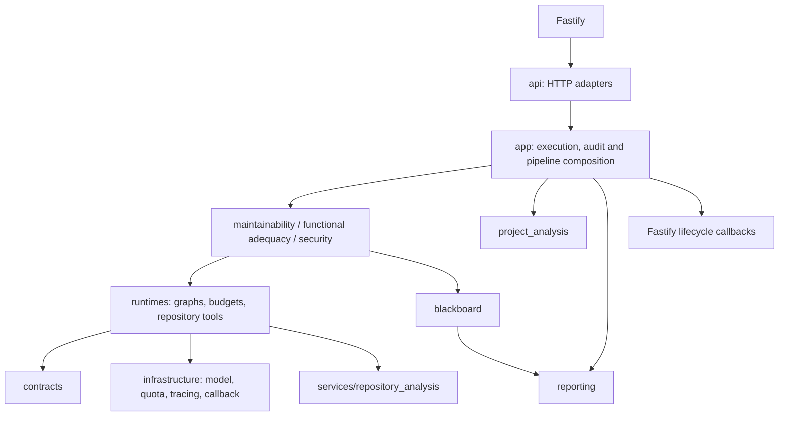

# Agent-server architecture map

See [`../AGENTS.md`](../AGENTS.md) for mandatory placement and configuration rules and
[`contracts.md`](contracts.md) for Fastify-facing behavior. This document is a navigation
map; implementation remains authoritative.

## Execution flow



## Owners and entry points

| Need to change | Start here | Then consult |
| --- | --- | --- |
| ASGI startup, shutdown, router mounting, global 422 redaction | `src/server/main.py` | `src/server/api/` |
| Direct `/api/agents/run` execution and provider overrides | `src/server/api/executions.py`, `src/server/app/execution_service.py` | `src/server/app/{execution_config,model_configuration}.py`, `src/server/infrastructure/llm/` |
| A new/changed named workflow | `src/server/app/pipeline_contracts.py`, `pipeline_registry.py`, matching `*_definition.py` | `src/server/pipelines/`, `src/server/api/pipelines.py` |
| Audit acceptance, status, cancel, report-generation retention | `src/server/app/audit_service.py`, `audit_state.py` | `src/server/app/audit_resources.py`, `quality_audit_definition.py`, `src/server/blackboard/` |
| Maintainability policy or topology | `src/server/agents/maintainability/<participant>/` | `src/server/runtimes/{investigation,coordination}/` |
| Functional adequacy retrieval or verification | `src/server/agents/functional_adequacy/agent.py`, `audit.py`, local `schemas.py` | `repository_adapter.py`, `config.py`, `prompts/` |
| Security scanning/remediation | `src/server/agents/security/audit.py` and component package | `security/config.py`, `runtimes/repository/` |
| Project orientation/architecture/semantic pipeline | `src/server/project_analysis/` | `src/server/pipelines/`, `src/server/app/project_architecture_definition.py` |
| Report schema, traceability, presentation | `src/server/reporting/` | `src/server/blackboard/`, `src/server/services/audit_diagnostics.py` |
| Repository snapshot, source access or tools | `src/server/services/repository_analysis/`, `src/server/runtimes/repository/` | `tests/repository_runtime/` |
| Agent configuration panel/defaults | `config/agents/` | `src/server/agents/<participant>/config.py` only for real specialization |
| Provider/model construction, diagnostics, client cleanup, retry/usage, global quotas | `src/server/infrastructure/llm/` | `src/server/runtimes/investigation/provider.py`, `src/server/runtimes/repository/model_runtime.py` |
| Fastify callback payloads | `src/server/infrastructure/callback/` | [`contracts.md`](contracts.md), `tests/test_usage_callbacks.py` |

`agents/` has exactly three implementation folders. Project analysis, report generation,
the dummy example, neutral contracts and execution infrastructure are deliberately outside it.

## State and resource ownership

- Each LangGraph state belongs to its graph owner: investigator `state.py`, coordinator
  `state.py`, manager `state.py`, or the project/functional/report graph implementation.
  Preserve state keys, reducers, node names, static/conditional routes and finish rules.
- `AuditService` owns process-local run/task state and the server Blackboard is created and
  closed by FastAPI lifespan. One audit shares its retained snapshot and root token ledger;
  child/invocation toolsets remain fresh and read-only.
- `PipelineDefinition` owns optional request-context binding and cleanup callbacks. The generic
  service preserves Blackboard binding for legacy/custom definitions; built-in functional and
  project pipelines consume context explicitly. Project model stacks close even if a later
  stage, hook binding, or graph composition fails.
- The direct execution service is created lazily only for definitions marked as needing it
  (functional adequacy, or legacy custom definitions without an explicit declaration). Project
  and quality pipeline setup no longer constructs the direct-agent registry just to resolve a
  model.
- Direct model execution and access verification close their constructed provider clients after
  successful, invalid-input, failed, and timed-out runs. Audit client caching/toolset policy is
  shared in `app/audit_resources.py`; audit-specific execution policy remains in `AuditService`.
- `RepositoryToolset` owns access checks, tool limits, retrieved-character accounting and
  provenance receipts. Do not replace it with raw filesystem or Git reads in agents.
- `infrastructure/llm/quota.py` owns global process-shared provider admission. Retry attempts
  reacquire quota; usage helpers must not charge one generation twice.
- `infrastructure/llm/diagnostics.py`, `usage.py`, and `resources.py` are SDK-facing helpers;
  `ModelGateway` and provider admission remain in `runtimes/` because they enforce run budgets.

## Dependency rules

```text
api/web → app composition → quality implementation → runtimes/contracts/infrastructure
                                      runtimes → contracts, shared config, deterministic services
```

`runtimes/`, `contracts/` and `infrastructure/` must not import `app/`, `api/` or concrete
agents. One quality implementation must not import another. Maintainability hierarchy is
manager → modularity/reusability → investigators; shared coordinator runtime has no registry
of concrete agents. Catalogs may resolve module paths lazily, without constructing execution
resources. `contracts/legacy_schemes/` exists only as a same-object compatibility boundary;
production code uses `contracts/audit.py`, `runtimes/coordination/contracts.py` and local
specialist schemas.

## Verification by change

| Change | Focused checks |
| --- | --- |
| HTTP/discovery | `tests/test_openapi_contracts.py`, `tests/test_agent_catalog.py`, `tests/test_model_access.py` |
| Pipeline/callback | `tests/test_generic_pipeline_service.py`, `tests/test_pipeline_ports.py`, `tests/test_quality_audit_pipeline.py`, `tests/test_usage_callbacks.py` |
| Audit/Blackboard | `tests/test_audits.py`, `tests/test_app_lifespan.py`, `tests/test_blackboard_publication.py`, `tests/test_audit_configuration.py` |
| Maintainability runtime/contracts | `src/test-agents/test_agent_schemes.py`, `test_shared_coordinator_runtime.py`, affected investigator/coordinator tests |
| Repository tools/providers | affected `tests/repository_runtime/` tests and `tests/test_global_provider_quotas.py` |
| Functional, security or reports | `tests/test_functional_adequacy_integration.py`, `tests/test_security_audit.py`, report/DOCX tests |
| Packaging/layout | `uv build`, then import and read prompts from a location outside the checkout |

Run Ruff on changed Python packages. `uv run --no-sync pytest ...` requires pytest to be
available in the environment; a missing executable is a blocked check, not a passing test.
SBERT retrieval may require cached model weights/network; do not trigger an implicit download.
