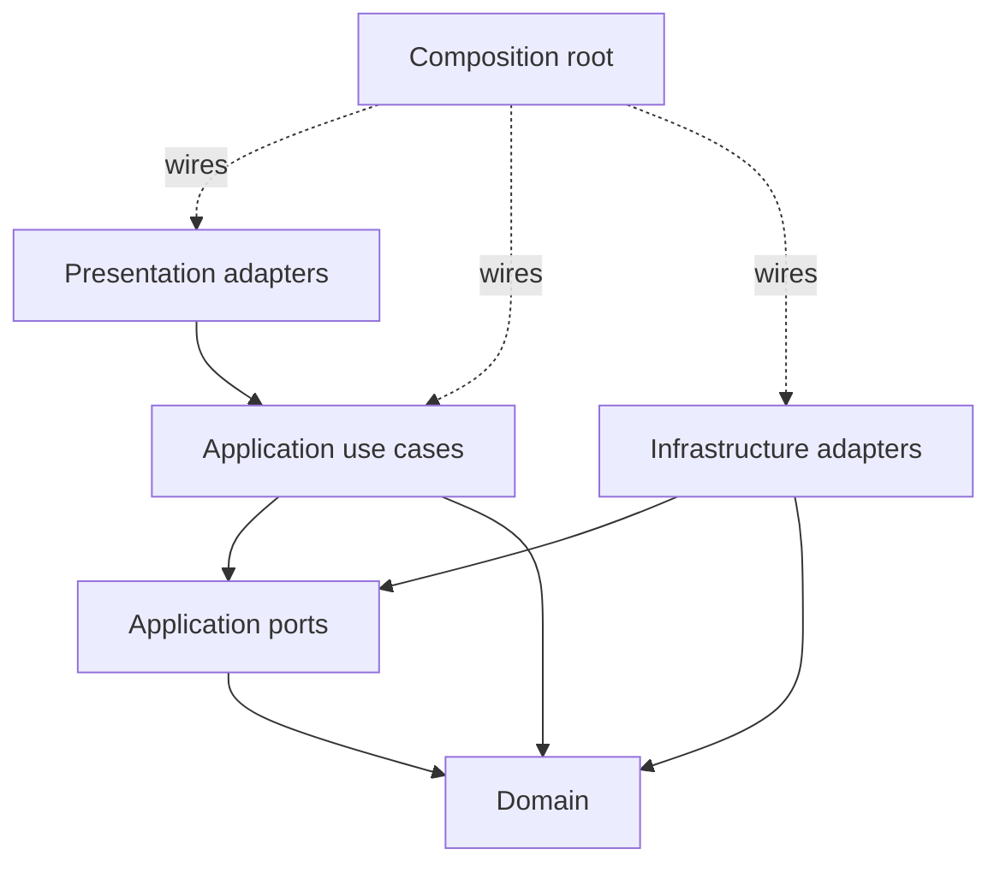

# ARC-102 — Component and Layer Model

**Architectural style:** Clean Architecture; dependency direction points inward.

## Logical layers

| Layer | Source ownership | Responsibility | Allowed imports |
|---|---|---|---|
| Domain | `shoplab/domain/` | Entities, value objects, policies, pure calculations, inward-facing domain contracts | Domain + standard-library-only primitives |
| Application | `shoplab/application/` | Use cases, orchestration, ports, typed input/output | Application, domain |
| Infrastructure | `shoplab/infrastructure/` | Concrete persistence, carrier, IDs, logging, outbound integrations | Infrastructure, application contracts, domain |
| Presentation | `shoplab/presentation/` | CLI, WSGI, formatting, request parsing | Presentation, application, domain DTOs where required, bootstrap assembly |
| Composition | `shoplab/bootstrap.py` | Construct adapters and inject through ports | All layers, solely for assembly |

Components should not be identified by folder names alone: their **active imports, data flows and invoked behavior** determine whether they respect boundaries. Domain entities do not know whether a client is CLI, WSGI, or a future queue processor.

## Functional components

**ProductCatalog:** `domain/catalog.py` and application `ProductCatalog` port; `infrastructure/memory_catalog.py` implements it.

**Pricing & promotion:** `domain/promotions.py` applies deterministic discounts. The `PromotionCatalog` port is owned by the application; `infrastructure/memory_promotions.py` supplies in-memory promotion records.

**Shipping:** `domain/shipping.py` describes parcel size and destination zones; `ShippingRateProvider` is an application port; concrete rates live in infrastructure.

**Quote workflow:** `application/quote_order.py` coordinates inward concepts and ports; `application/get_quote.py` and `application/list_products.py` are query use cases.

**Transport adapters:** `presentation/cli.py` and `presentation/http_api.py` translate user input to application request objects. They do not implement pricing rules.

**Legacy feature packages:** `billing`, `inventory`, `orders` represent a pre-existing functional package organization being incrementally isolated behind public entry points. Their presence is not an exemption from the adopted architecture rules; their migration work is documented in ARC-109.

## Dependency rule at a glance

The diagram shows allowed directions, not every observed repository dependency. A *horizontal* dependency across modules must respect each module's public contract, even if the modules occupy similar technical layers.

## Ownership and replacement boundaries

Every concrete adapter may be replaced without importing its implementation in a domain entity or use case. Application-owned `Protocol` interfaces specify the needs of the use case, not implementation details such as dictionaries, SQL cursors, or HTTP responses.
