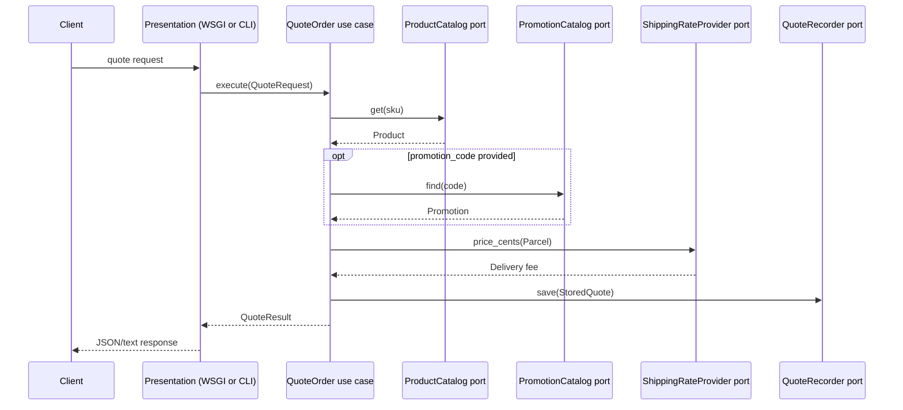

# ARC-104 — Runtime, Data and Behavioral Views

## Scenario A: quote request

A client submits an SKU, quantity, destination zone and optional promotion code. Presentation validates the JSON/CLI shape. `QuoteOrder` obtains a `Product` through `ProductCatalog`, a promotion through `PromotionCatalog`, and a delivery cost through `ShippingRateProvider`. It stores an immutable `StoredQuote` through `QuoteRecorder`, then returns a DTO for serialization.

This is the **intended logical flow** for the new quote slice. It does not prove unrelated existing order-processing modules conform to every rule.

## Scenario B: legacy checkout

`shoplab.app` calls `application.checkout.process_order`, which coordinates the old inventory, orders, billing and notification packages. The process uses shared in-memory stock state in `inventory._store.STOCK`. This execution pathway remains available for compatibility. As part of its migration, every dependency must be checked against ARC-103 rather than automatically treated as approved.

## Storage ownership and consistency

| Data | Owner | Mechanism | Durability |
|---|---|---|---|
| Active catalog products | Catalog adapter | Python dict | Process-local |
| Discount policies | Promotions adapter | Python dict | Process-local |
| Quotes | Quote recorder | Python dict | Process-local |
| Legacy stock | Inventory subsystem | Python dict | Process-local |

Quotes and inventory reservations are separate operations and are not transactionally linked. There are no background retries, outbox, persistence guarantees or optimistic locks in this demonstrator.

## Failure handling

- Unrecognized or inactive SKU: application rejects the quote.
- Invalid quantity, promotion code or parcel weight: application returns a typed error.
- Invalid JSON or missing request data: inbound adapter responds `400 Bad Request`.
- Unknown route: inbound adapter responds `404 Not Found`.
- Unexpected adapter errors: propagate to the local developer; deployment-grade exception handling remains outside this scope.

## Money semantics

New quote amounts use integer **cents** to avoid floating-point price drift. Percentage discounts use floor integer division. Delivery charges are additive, and quoted totals never imply payment collection.
