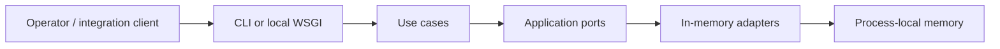

# ARC-107 — Deployment and Operations

## Executable entry points

| Entrypoint | Purpose | Address / output |
|---|---|---|
| `python -m shoplab.app` | Legacy in-memory checkout | Console |
| `python -m shoplab.presentation.cli` | Catalog and quote commands | JSON stdout |
| `python -m shoplab.presentation.http_api` | Development-only WSGI service | Loopback port 8765 |
| `python -m unittest discover -s tests -v` | Local regression suite | Test report |

## Deployment topology

A **single Python process** hosts application, adapters, in-memory state and optional inbound HTTP surface. It does not connect to an external database, carrier API or message broker. The quote and legacy order stores are separate in-memory mechanisms. Restarting the process discards runtime state.

## Health

`GET /health` returns a small process-alive JSON document. It is not a readiness probe for storage integrity or a guarantee of business availability.

## Development operation

Run the HTTP server only on loopback, and do not publish it to an untrusted network. It has no auth, request identity, robust logging, DoS controls or persistence. No production SLA, disaster recovery objective or backup procedure is defined.

## Configuration

Runtime requires Python 3.10+. The project does not require environment variables, secrets or external APIs. For noneditable execution, set `PYTHONPATH=src`; editable installation via `pip install -e .` is preferred.

## Roadmap constraints

Productionizing would require durable storage, transactional stock reservation, authentication, authenticated outbound gateways, dependency health checks, structured logging and deployment configuration. These are deliberately out of scope for the current executable example.
