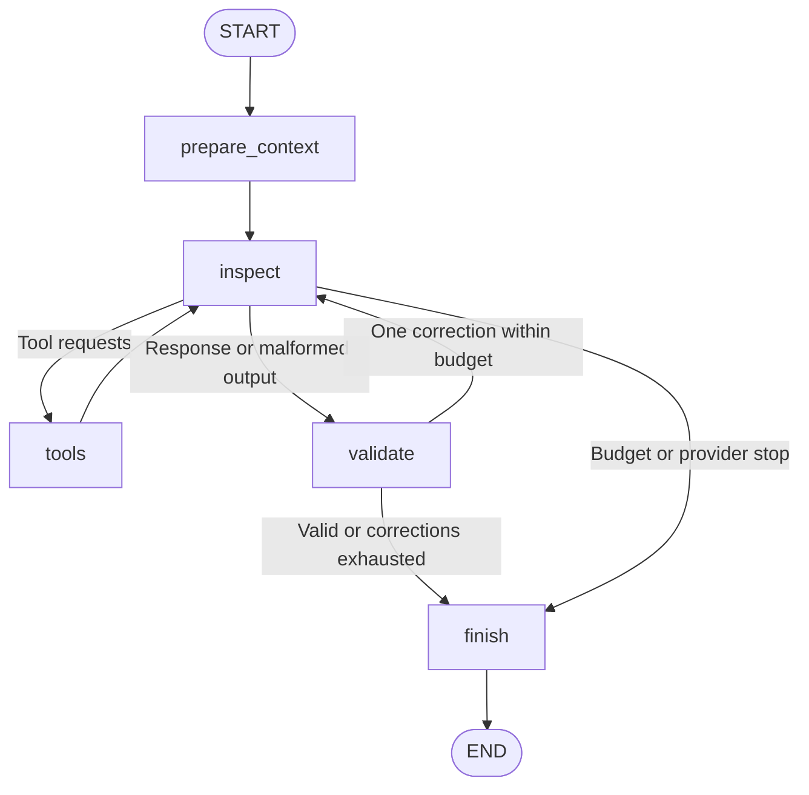

# Focused Architecture Agent

`ProjectArchitectureAgent` interprets the observed architecture from the retained
repository representation and inspected implementation. It explains organization,
the closest pattern, supporting decisions, deviations/tensions, relevant
infrastructure, and a brief summary with scoped uncertainty.

## Run

From `agent-server`:

```powershell
uv run python -m server.run_project_architecture ../appdata/workspace/1373928788-Cesar-Sanchez-sof-Polleria
uv run python -m server.run_project_architecture ../appdata/workspace/1373928788-Cesar-Sanchez-sof-Polleria --json
uv run python -m server.run_project_architecture ../appdata/workspace/1373928788-Cesar-Sanchez-sof-Polleria --smoke
```

The dedicated runner prepares one snapshot, runs orientation, then gives that
orientation and the same snapshot to the architect. Each role has a fresh restricted
tool/evidence ledger. Orientation conclusions are navigation hints; the architect
must retrieve its own source before using a claim as supported.

`--skip-orientation` runs the architect directly over the representation.
The dedicated runner uses `repository_runner.py` for provider configuration,
progress, limits, telemetry, and cleanup. The installed entrypoint is
`project-architecture`. Its result is the snapshot-bound validator handoff.

## LangGraph and Limits



Only `inspect` calls the model. Initial source inspection uses a tool-only contract;
the full architectural response contract becomes available after source from at
least two files is delivered (or the available file count for a smaller repository).
The model selects the files and ranges. Final validation additionally requires
supported pattern classifications to span different observed responsibilities.
The prompt retains a compact source-evidence ledger even when old excerpts leave
the working context, so citation IDs and actual ranges are not lost. Missing source
can be requested again if interpretation needs it.
Context pruning removes navigation metadata before source and preserves the two
most recent distinct source files. It also trims nested symbol hints and project
metadata, reserves room on the initial turn, and bounds actual source retrievals
to the configured source character target with explicit ranges/truncation. If that
irreducible context exceeds the input target, advisory mode submits it with a
diagnostic; strict mode stops explicitly instead of silently dropping all source.
The shared `working_context.py` implements this policy for both orientation and
architecture. `context_rejected` shows the rejected prompt's size breakdown,
conservative input estimate, budget remainder, output reserve, and reason, without
printing source or prompts. Independently valid draft sections survive later stops.
Once source has been delivered, fitting may remove the remaining candidate/project
navigation entries as well; their initial minimum counts must not prevent a
source-bearing follow-up from fitting the richer classification contract. Inspected
paths and evidence ranges remain available in the source ledger.

The architect has at most **8 logical model calls, 20 tool requests, one correction**.
Architecture-mode runner defaults are **10,000 input tokens/call, 40,000 tokens per
objective, and 80,000 total pipeline tokens**. Explicit CLI token/call/tool limits
take precedence. Other runner modes retain their previous token defaults. The
architecture prompt ceiling is 36,000 characters, still subject to token admission.
Source ranges may contain up to 2,400 characters; retrieval scales this down when
the caller supplies a smaller input budget or measured token density increases.
Library callers provide token targets through their tool context.
Architecture token targets and the context character target are advisory by default:
fitting still reduces navigation metadata, but an irreducible source-bearing prompt
may exceed them. `budget_advisory` reports the reason and sizes without cancelling
submission or remaining provider retries. This also applies to total/objective
estimates inflated by unknown-usage attempts after provider errors; accounting remains
conservative and complete usage remains unknown. Targets are not guaranteed cost caps.
Call/tool counts, elapsed time, provider output limits and configured retry counts
remain enforced. Exhausted provider retries still stop with a provider failure.
Use `--strict-architecture-budgets` or `ArchitectureLimits(soft_token_budgets=False)`
to enforce token/context admission. Orientation retains strict admission.
Orientation has at most four calls/six tools. Lower runner limits are respected by
each stage. Provider retries are separate, bounded attempts. The pipeline shares
the total token admission limit and elapsed-time limit; per-objective token limits
apply independently to orientation and architecture. The basic flow has no model
planner, synthesis stage, follow-up queue, or persistence. Semantic review is opt-in
through `--validate-semantics` and adds its own bounded investigation and optional return.

Orientation-only defaults are 60,000 total, 6,000 input per call, and 20,000 per
objective. Both runners default to 3,000 output tokens per call. Adjust the
architecture objective allowance when calibration warrants it, for example:

```powershell
uv run python -m server.run_project_architecture ../appdata/workspace/563728375-szymon6927-hexagonal-architecture-python --max-objective-tokens 30000 --json
```

## Output and Evidence

The `architecture` object contains:

1. `organization` and `connections`: responsibilities and scoped boundaries.
2. `closest_architecture`: pattern and an assessment, including uncertainty.
3. `supporting_evidence`: implementation decisions supporting the interpretation.
4. `deviations`: observed decisions, inferred pattern expectations, and explanations.
5. `infrastructure`: execution units, communication, or state; `configured` and
   `inspected_use` are separate observations.
6. `explanation` and `uncertainties`: concise architecture description and gaps.

Candidate selection reserves implementation entrypoints for each detected project
before adding architectural role hints. `application_targets` and deterministic
`application_coverage` stay visible to the model even when navigation metadata is
pruned. Projects containing only data/manifests, test fixtures or configuration do
not become application targets. Frontend inspection should follow a representative
entry/page, component/state/hook and API client rather than stop at a package manifest
or UI barrel. The source suffix heuristic is bounded and may omit unsupported languages.

Before closure, each implementation-bearing project needs an organization unit:
either an inspected supported responsibility or an explicit hypothesis/unresolved
responsibility with limitations. Missing application coverage and missing endpoint
evidence route back to investigation while calls/tools remain. They do not consume
the one format correction. Repeated evidence failures without additional tool work
receive one final assessment turn instead of looping on the same report. Provider failures and limits
still preserve independently valid sections.

The result includes host-assembled `application_coverage` entries with project ID,
path, inspected implementation file IDs, status (`explained`, `inspected`,
`uninspected`) and a reason. `explained` means supported responsibilities cite at
least two implementation files from the project when available (one for a single-file
project), not that its full architecture is semantically established. A lone router
or entrypoint therefore remains insufficient coverage for a larger application.
Pending applications are added to uncertainties and prevent `complete` status.

Architectural closure also requires `closest_architecture` and `explanation`, even
when the interpretation is a hypothesis or an unresolved no-clear-pattern conclusion.
If evidence recovery makes no additional tool progress, the model gets one final
assessment turn within the existing call/time limits. A proposed supported pattern
that fails support validation can be retained as a hypothesis if its assessment's
own source references remain valid; rejected path/contrast details are omitted and
the host downgrade is explicit in limitations. This does not preserve unsupported
facts as accepted evidence. When no valid model assessment or explanation survives,
the host inserts clearly labeled unresolved fallbacks rather than leaving nulls.
Fallbacks do not infer a pattern and cannot yield `complete` status.

### Connected pattern investigation

`discovery.py` builds at most two connected investigation bundles from existing
snapshot imports and inheritance/implementation relationships. Filename conventions
such as `*.service.ts`, `*.repository.port.ts`, `*.repository.ts` and Python abstract
ports complement directory roles. A bundle pairs a use case consuming a port with
an adapter implementing it and, when available, its composition module/bootstrap.
Importing a port alone does not qualify a file as its implementation. These are
navigation hints, not deterministic architecture classifications; all support still
requires the architect's own source tools. Hidden tooling configuration is excluded
from implementation candidates. Relationship hints carry file paths and prioritize
internal links among selected files over unrelated containment/external facts.

Bundles remain visible while other metadata is pruned and acquire actual inspected
source IDs/ranges per member. Source fitting protects the newest excerpt for every
member of the primary bundle, in addition to recent distinct sources, so the model
does not lose the use-case/port code before interpreting the adapter. This can exceed
token targets in advisory mode; strict mode still enforces admission.

`observed_dependencies` allows a supported connected graph such as
`UseCase -> Port <- Adapter` instead of forcing an artificial linear runtime path.
Each dependency still cites both declared responsibilities. A local pattern can be
supported without proving repository-wide purity; decorators and scoped boundary
tensions do not automatically negate hexagonal pattern presence. Contrast can use
the inspected use case and composition to test direct concrete-adapter dependency.
Repository scope retains the stronger independent-path requirement.

`closest_architecture.assessment_origin` distinguishes `model`, `host_downgrade`
and `host_fallback`. The host sets this field during report assembly; it is not an
instruction to the model. It makes a failed evidence contract distinguishable from
a hypothesis deliberately chosen by the model.
Classification path/dependency links may reuse source evidence from an already
supported report connection with the same directed endpoints. That report connection
must independently pass the two-endpoint source checks; reuse adds no fabricated
citations or new relationship. This avoids downgrading a pattern solely because
the model did not repeat the same endpoint ID list in both places. Invalid-source
feedback names the offending claim/IDs and gives the inspected path-to-ID map.
Endpoint citations from supported organization responsibilities can also be reused
when the same directed dependency is resolved in the snapshot's internal import or
inheritance/implementation graph and the link itself cites at least one participating
file. Both endpoints must have their own inspected source evidence. Unresolved,
external or guessed runtime connections do not acquire endpoint support this way.
This establishes traceability of a structural dependency, not semantic acceptance
of an arbitrary mechanism described by the model.
The protocol also resolves a file-shaped citation alias (`file:<id>` or the mistaken
`retrieval:<file-id-suffix>`) only when that file has exactly one distinct source
range in the architect's own ledger. It never resolves an uninspected file, an
arbitrary identifier, or an ambiguous multi-range reference. The actual snapshot-bound
source ID is used in all claims/citations and each alias repair is exposed in
`reference_repairs` and an `architecture_reference_normalized` progress event.

Final direct real-model checks of both pinned hexagonal examples with
`gemini-3.1-flash-lite` produced `complete` reports and `Hexagonal / supported`
classifications of local scope, with `assessment_origin=model`, two model calls
and four source requests each. Python inspected the client service, repository port,
MongoDB adapter and bootstrap (14,497 reported tokens). TypeScript inspected the
create-user service, repository port, repository adapter and user module (14,338
reported tokens; one failed attempt had unknown usage, so complete totals are null).
Three TypeScript file-shaped source aliases were repaired and exposed in the result.
These are bounded source/contract results, not global compliance scores. Spot checking
still found imprecise terminology in the TypeScript contrast (calling the use case
the domain and saying it imports only the port despite other imports); the main
dependency-inversion interpretation is supported by the inspected code, but narrative
semantic acceptance remains a separate responsibility. Full suite: **305 tests passed**.

Every architectural claim has statement, scope, status, evidence IDs, and limitations.
Supported claims require source delivered during the architect's investigation.
Supported unit responsibilities cite their own files. Supported connections cite
both responsibilities; supported classifications require multiple files across
at least two observed responsibilities. This checks provenance, not whether the
model's interpretation is semantically sufficient.

Supported classifications now also require `observed_paths`: one or two arrays of
supported connections forming continuous chains between declared responsibilities.
Each edge cites both endpoints and describes the concrete mechanism. The assessment
must cite an inspected path. `contrast_question` names a possible contradiction;
`contrast_result` records a source-backed, scoped observation about that question.
All path and contrast evidence belongs to the architect's own snapshot-bound ledger
and is included in the citation table. Missing evidence permits a hypothesis with
limitations, rather than forcing a supported pattern.

`scope_kind` defaults to `local`: use a precise assessment scope for the observed
path. `repository` requires two paths with different inspected file sets. These
structural checks reject repeated evidence, broken chains, invented contrast IDs,
and missing endpoints. They do not establish that paths are semantically independent
or that a contrast genuinely tests the pattern; those remain interpretation/validator
responsibilities. Prompts require responsibility/dependency direction, a focused
counterexample check, and configuration/initialization/use distinctions for infrastructure.

The host assembles `citations` from accepted source evidence: evidence ID, file ID,
repository-relative path, actual line range, and content hash. The result includes
snapshot identity, retrieved evidence, inspected files, limitations, execution
issues, usage, and telemetry. These allow an independent validator to inspect material
claims directly against the same snapshot without inheriting the conversation.

Mixed/partial styles and no clear pattern are valid interpretations. Names alone
do not establish architectural separation. A mismatch with an inferred style is
not automatically a defect. Configured infrastructure does not prove production
deployment, and declared technology does not establish runtime usage.

`complete` means the bounded report has organization, classification, explanation,
multi-file inspection, and no execution/validation failures. It does not mean global
compliance or semantic acceptance. Invalid sections are discarded independently;
useful surviving sections produce `partial`. No substantive report means `failed`.

`usage` and `telemetry` concern the architect only. `orientation_result` contains
the earlier stage; `pipeline_usage` shows combined reported consumption. Complete
provider totals remain null if any attempt lacks usage; known reported counts
remain available separately from conservative token estimates.

## Files and Library API

The implementation lives under `src/server/agents/project_architecture/`:
- `agent.py`: typed LangGraph state and bounded investigation/recovery routing.
- `prompting.py`: source-first prompt fitting and measured contracts.
- `projection.py` and `discovery.py`: balanced candidates and connected dependency hints.
- `coverage.py`: implementation-bearing applications and evidence-depth closure.
- `context.py`: source references, audited aliases, validation, and section salvage.
- `results.py`: scoped result assembly; `schemas.py`: contracts; `smoke.py`: offline model.

Prompts are runtime-loaded
from `prompts/system.md`, `architecture_criteria.md`, `investigation.md`, and
`correction.md`; they participate in reproducibility fingerprints.

```python
from server.agents.project_architecture import ProjectArchitectureAgent

result = await ProjectArchitectureAgent(model).run(architecture_tools, orientation_result)
```

Use fresh snapshot-bound tools; the caller owns model resources. Passing orientation
from another snapshot fails before a model call. Tools retain checkout isolation
and narrative documentation exclusions, including indirect evidence retrieval.
The installed CLI entrypoint is `project-architecture`.
Diagram composition runs by default (one compact model call after investigation);
`--no-diagram` skips it. On success it prints
the architect's selected component view as Mermaid (or exports it with `--json`).
The structured view is source-linked and its relation types, groups, and scope are
reviewed semantically. See [architecture diagrams](architecture-diagrams.md).
`--validate-semantics` adds independent claim review and at most one evidence-return
round; `--no-semantic-return` keeps review standalone within the pipeline. The original
architecture remains the top-level result. See [semantic validation](project-semantic-validation.md)
for verdicts, correction proposals, pending coverage, and revision history.
See [the shared runtime guide](repository-runtime.md) for tool construction and runner options.

## Verification and Initial Calibration

`uv run --no-sync pytest -q`: **271 tests passed**. Targeted Ruff checks passed.
Architect checks cover multi-file classification/connection references, exact source
citations, snapshot mismatch before model submission, independent orientation evidence,
configuration versus implementation, docs/neighbor access, bounded calls/tools,
token stops, external cancellation, partial recovery, and the dedicated runner.

Initial real Google `gemini-3.1-flash-lite` calibration used a 30,000-token objective
allowance, 150 seconds, and no provider retries:

| Case/run | Status | Architect calls/tools | Architect reported tokens | Combined reported tokens |
| --- | --- | --- | ---: | ---: |
| Hexagonal Python, with orientation | partial | 5 / 10 | 18,954 | 26,141 |
| FastAPI, with orientation | partial | 3 / 4 | 12,845 | 20,165 |
| Polleria, with orientation | failed | 0 / 0 | No architect request | Unknown |
| Hexagonal Python, later direct run | partial | 5 / 10 | 19,972 | 19,972 |

The Polleria run stopped after a provider failure in orientation; no architect
request was sent and the combined complete usage was unknown. Earlier diagnostics
also revealed that the model tried to classify from guidance without source; the
tool-only initial contract now requires source inspection before classification.

The later Hexagonal Python run retained domain/application/infrastructure organization
and a scoped ports-and-adapters classification, citing `client.py`, `client_service.py`,
and `dropbox_clients_exporter.py`. Invalid citation-bearing sections were rejected,
so the report remained partial. A compact evidence ledger was added after the first
calibrations to retain citation identity as working context is pruned.

Source spot checks show both useful observations and remaining semantic overstatement:
`ClientService` receives repository/exporter abstractions and calls the repository;
`DropboxClientsExporter` implements the exporter abstraction and uploads reports.
Those files support the scoped separation, but do not establish global strict
hexagonal compliance or prove persistence behavior merely from an exporter. The
FastAPI run also compared a framework integration against an unrelated Clean
Architecture expectation; the prompt was clarified to compare deviations with the
selected style. No complete semantic acceptance or stable repeated-run quality is
claimed from these calibration runs. The future validator should review such
material claims and expand inspection only where evidence is insufficient.
Final prompt/context refinements compacted repeated instructions and source envelopes
and protected recent multi-file source from pruning. Direct offline Hexagonal Python
verification then completed with a partial protocol result in two calls/two tools;
these refinements are not a new scored real-model quality evaluation.

The subsequent Veraud monorepo context regression was fixed without raising the
6,000-input-token default. Offline orientation and architecture both reached a
second call containing source. A real direct architecture run produced partial
output in three calls/four tools and 12,566 reported tokens; invalid cross-unit
connection evidence was rejected. The combined real run was interrupted by a
provider ServerError after sending orientation's source-bearing second prompt.
The regression suite covers large/nested metadata, distinct-file source protection,
actual bounded ranges, retained source IDs, and pre-submission rejection diagnostics.
Full suite after this correction: **277 tests passed**.
